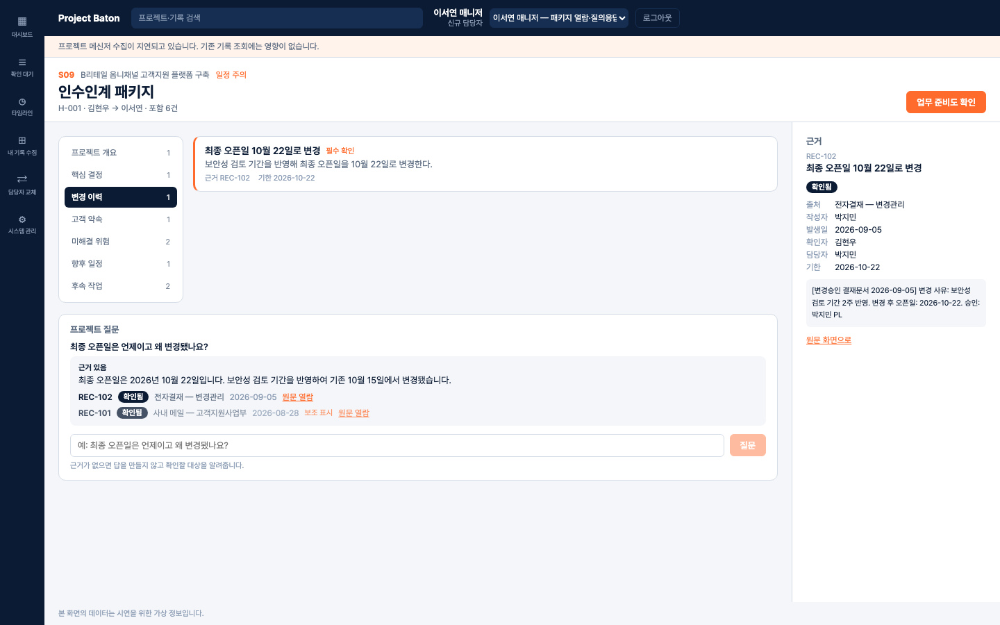
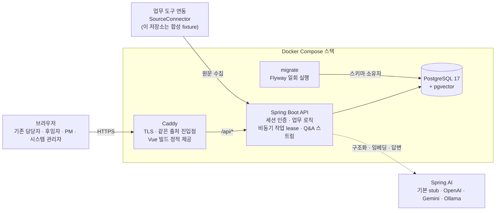
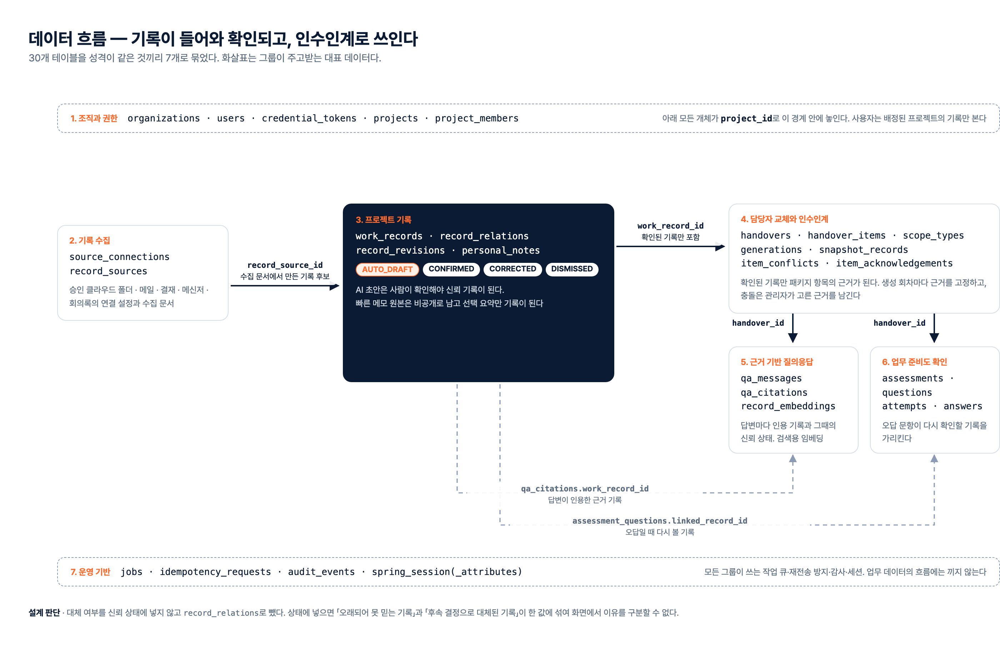

<div align="center">

# Project Baton

### 담당자가 바뀌어도 프로젝트 맥락은 끊기지 않습니다

Project Baton은 메일·결재·메신저·회의록·업무 폴더·개인 메모에 흩어진 프로젝트 기록을 **사람이 확인한 근거**로 쌓아 두고,<br/>
담당자가 바뀔 때 그 근거만으로 **인수인계 패키지·질의응답·업무 준비도 확인**을 제공하는 사내 인수인계 서비스입니다.

[공개 데모](https://baton.gwang.dev) · [API 명세](ProjectBaton-API.yml) · [설계 문서](docs/backend-design/README.md) · [검증 증거](docs/backend-design/evidence/)

`Status: Portfolio` · 공개 데모 운영 중 · 모든 데이터는 합성 데이터



</div>

---

## 제품 구성

| 구성 요소 | 역할 |
|---|---|
| **기록 수집과 확인** | 연결한 업무 도구의 원문을 AI가 여섯 가지 기록(일정·변경 결정·고객 약속·장애요인·범위 예외·미해결 결정)으로 구조화합니다. AI 결과는 초안(`AUTO_DRAFT`)으로만 남고, 사람이 원문과 대조해 승인하거나 고쳐야 신뢰 기록이 됩니다. |
| **빠른 메모** | 통화·복도 대화처럼 시스템 밖에서 생긴 내용을 남깁니다. 원본은 작성자에게만 보이고, 고른 요약만 프로젝트 기록으로 공유됩니다. |
| **인수인계 패키지** | PM이 담당자 교체를 요청하면 확인된 기록만으로 패키지를 만듭니다. 서로 상충하는 기록은 패키지의 검토 항목이 되고, 관리자가 최종 근거를 고르기 전까지 인수인계를 완료 승인할 수 없습니다. |
| **근거 기반 질의응답** | 후임자의 질문에 패키지의 확인된 기록만 검색해 인용과 함께 답합니다. 근거가 없으면 답을 지어내지 않고 확인할 사람과 문서를 알려 줍니다. |
| **업무 준비도 확인과 승인** | 후임자가 핵심 문항에 답하고, 틀린 문항은 다시 볼 근거 기록으로 연결됩니다. PM은 준비도·미확인 기록·충돌 처리 결과를 보고 완료를 승인하거나 보완을 요청합니다. |

## 해결하려는 문제

여러 고객 프로젝트를 동시에 수행하는 SI·IT서비스 조직에서 **담당자가 갑자기 바뀌는 상황**을 다룹니다.

| 문제 | 현재 상황 | Project Baton의 방식 |
|---|---|---|
| **교체 뒤에야 시작하는 인수인계** | 평상시 기록이 인수인계 관점으로 정리되지 않아, 교체가 정해진 뒤 급하게 문서를 만듭니다. | 이미 있는 업무 기록을 평소에 구조화하고 담당자는 짧게 확인만 합니다. |
| **최종 결정을 가리기 어려움** | 여러 채널과 버전이 섞여 무엇이 최종 결정이고 왜 바뀌었는지 알기 어렵습니다. | 원문 출처와 확인 상태를 함께 두고, 대체·상충 관계를 명시적으로 연결합니다. |
| **전임자 의존** | 결정 배경과 예외 합의가 개인의 기억과 메모에만 남습니다. | 확인된 기록으로 패키지를 만들고, 후임자는 질문으로 빈 곳을 채웁니다. |
| **AI 결과를 믿기 어려움** | 근거와 사람의 확인 여부가 보이지 않으면 AI 요약을 업무 사실로 쓸 수 없습니다. | 사람이 확인한 기록만 근거로 쓰고, 모든 답변에 출처와 신뢰 상태를 보입니다. |
| **문서 전달 = 완료라는 착각** | 후임자가 실제로 업무를 이어받을 준비가 됐는지 알 수 없습니다. | 준비도 확인과 PM 승인을 거쳐야 인수인계가 끝납니다. |

## 시스템 아키텍처



- **AI가 멈춰도 업무는 계속됩니다.** 로그인·기록 조회와 확인·패키지 항목·관리는 AI를 거치지 않습니다. 기본 구성은 오프라인 `stub`이고, 외부 모델은 환경변수로 고릅니다.
- **앱 계정은 감사 기록을 지우거나 바꿀 수 없습니다.** 배포에서 앱은 아무것도 소유하지 않는 `baton_app` 계정으로 접속하고, 감사 행에는 보존 기간이 지난 로그인 주소를 비우는 수정만 허용됩니다. 스키마 변경은 소유자 비밀번호를 가진 일회용 `migrate` 컨테이너만 합니다.

## ERD



30개 테이블을 7개 그룹으로 나눴습니다. 전체 관계도는 [`ERD-Appendix-전체테이블.png`](artifacts/erd/ERD-Appendix-전체테이블.png), 테이블별 역할은 [`db-list.md`](artifacts/erd/db-list.md), 원본은 [`ProjectBaton-DB.dbml`](ProjectBaton-DB.dbml)입니다. 그림은 `tools/erd_export.py`가 DBML에서 다시 만듭니다.

### 설계 경계

- **AI는 초안까지만** — 구조화 결과는 `AUTO_DRAFT`로 저장되고, 사람이 승인(`CONFIRMED`)하거나 고쳐서 승인(`CORRECTED`)해야 패키지 근거와 검색 대상이 됩니다. 파서는 모델 출력이 스키마를 어기면 고쳐 쓰지 않고 거절합니다.
- **대체·상충은 상태가 아니라 관계** — 「오래되어 못 믿는 기록」과 「후속 결정으로 대체된 기록」을 한 상태값에 섞지 않도록 `record_relations`(SUPERSEDES·CONFLICTS_WITH)로 분리했습니다. 한 기록 쌍에는 하나의 관계만 둡니다.
- **충돌마다 검토 항목 하나** — 상충 관계 하나가 패키지의 검토 항목 하나가 되고, 관리자가 최종 근거를 고르기 전까지 완료 승인이 막힙니다. 시스템이 임의로 고르지 않습니다.
- **근거가 없으면 답하지 않음** — 질의응답은 패키지 생성 시점에 고정한 확인 기록의 스냅샷만 검색합니다(pgvector 벡터 검색 + 키워드 보강). 검색된 근거 밖을 인용하거나 인용 없이 답하면 그 답변은 내보내지 않습니다.
- **느린 작업은 접수와 완료를 분리** — 패키지 생성은 `202 Accepted`로 접수하고 DB의 작업 큐(lease·heartbeat·재시도)가 처리합니다. 화면은 상태를 조회합니다.
- **개인 메모 원본은 비공개** — 메모를 공유해도 원본은 작성자에게만 보이고, 고른 요약만 프로젝트 기록이 됩니다.
- **감사는 추가만** — 감사 행의 수정·삭제는 DB 트리거가 막고, 배포에서는 앱 계정의 컬럼 권한이 한 번 더 막습니다.
- **외부 전송은 명시적 승인** — OpenAI·Google을 고르면 `BATON_AI_EXTERNAL_TRANSMISSION=approved`가 없을 때 앱이 기동을 멈춥니다.

## 공개 데모

`https://baton.gwang.dev`. 합성 데이터만 담은 공개 데모이며, 데이터는 매일 04:00(KST)에 처음 상태로 돌아갑니다. 실제 개인정보나 회사 자료를 입력하지 마십시오. 로그인하면 접속 주소(IP)가 감사 기록에 남고, 매일 초기화 때 함께 지워집니다. AI는 오프라인 stub입니다.

| 사번 | 이름 | 역할 |
|---|---|---|
| A-10421 | 김현우 | 기존 담당자 |
| A-10733 | 이서연 | 후임자 |
| A-10188 | 박지민 | 프로젝트 관리자(PM) |
| A-10002 | 최도윤 | 시스템 관리자 |

비밀번호는 네 계정 모두 `baton-zqes-569r`입니다. 시연용으로 공개한 값이고 다른 곳에서 쓰지 않습니다. 인수인계 한 바퀴는 PM이 교체를 요청하고, 후임자가 항목을 확인하고 준비도 확인에 응시한 뒤, PM이 승인하는 순서입니다.

## 저장소 구성

| 위치 | 책임 | 주요 기술 |
|---|---|---|
| [`backend/`](backend/) | 인증·권한, 기록 수집과 확인, 인수인계 패키지, 근거 검색과 답변, 준비도 확인, 감사, 비동기 작업 | Java 21, Spring Boot, Spring AI, JPA, Flyway |
| [`frontend/`](frontend/) | 화면 12개(S01–S12). `api` 모드는 실제 백엔드, `demo` 모드는 메모리 시나리오 | Vue 3, TypeScript, Vite, Pinia |
| [`infra/`](infra/) | 프록시(Caddy), DB 계정 생성, 백업, 관측(Prometheus·Grafana), 공개 데모 초기화·호스트 설정, AWS 정책 템플릿 | Docker, Caddy, nftables, systemd |
| [`tests/`](tests/) | 부하(k6), 배포 구성, 복구·백업, 관측, 전송 할당 확인 | Bash, k6, Docker Compose |
| [`docs/`](docs/) | 설계 계약·작업 카드·단계별 검증 증거, 운영 절차(접속기록 점검, AWS 배포) | Markdown |
| [`artifacts/`](artifacts/) | ERD·API 그림(현재 DBML·OpenAPI에서 생성), 아키텍처·UI 흐름도·화면 캡처(1단계 설계 시점) | Mermaid, HTML |
| 루트 | API 계약 [`ProjectBaton-API.yml`](ProjectBaton-API.yml), 데이터 모델 [`ProjectBaton-DB.dbml`](ProjectBaton-DB.dbml), 공개 endpoint 목록 [`SPEC.yaml`](SPEC.yaml), Compose 구성 | OpenAPI 3.0, DBML |

<details>
<summary>디렉터리 전체</summary>

```text
backend/          Spring Boot 백엔드
compose*.yml      운영형 구성(compose.yml)과 로컬 HTTP overlay(compose.dev.yml)
infra/proxy/      같은 출처 진입점(Caddy + 운영용 Vue 빌드)
infra/observe/    관측 구성(Prometheus 설정·경보 규칙, Grafana 화면)
infra/db/         배포의 DB 계정 생성(앱·점검 계정)
infra/demo/       공개 데모의 기준 덤프와 매일 초기화
infra/host/       공개 데모 호스트 설정(전송 상한·할당, 연결 한도, systemd)
infra/aws/        AWS 정책 템플릿(OIDC, ECR)
tests/load/       부하 시험(k6)과 합성 seed
tests/deploy/     배포 전 확인(Compose 스택 기동, 공개 데모 배포 구성)
tests/host/       호스트 전송 할당 확인
tests/observe/    관측 구성 확인
tests/recovery/   백업·복원 확인, 월간 복원 연습
tests/backup/     야간 백업의 보존 규칙과 백업·복원 확인
docs/backend-design/  백엔드 설계 계약, 작업 카드, 단계별 증거(evidence/)
docs/operations/      운영 절차(접속기록 점검, 공개 데모 AWS 배포)
frontend/         Vue 프론트엔드
artifacts/        ERD·API 그림(현재 DBML·OpenAPI에서 생성), 아키텍처·UI 흐름도·화면 캡처(1단계 설계 시점)
tools/            API 계약 검사기, AI 평가 세트·다이어그램 생성기
```

</details>

코드 주석은 한국어로 씁니다. 다만 Flyway가 주석까지 체크섬으로 검사하는 버전 마이그레이션(`V*.sql`)은 이미 적용된 DB를 깨지 않도록 처음 쓴 영어 그대로 두고, Gradle이 만든 `gradlew`도 손대지 않습니다.

## 기술 스택

| 영역 | 기술 | 적용 범위 |
|---|---|---|
| Web |     | SPA, 역할별 화면, Q&A 스트림 표시 |
| Application |      | REST API, 세션 인증·CSRF, 도메인 로직, 작업 큐, 스키마 이력 |
| AI |     | 기록 구조화, 임베딩(256차원), 근거 기반 답변 |
| Data |   | 업무 데이터, 세션, 작업 큐, 감사, 벡터 검색 |
| Delivery |     | 컨테이너 구성, TLS·정적 제공, CI·arm64 이미지, 공개 데모 호스트 |
| Observability |   | 요청·오류·p95, 자원, 부하 시험 화면 |
| Test |      | 단위·통합(실제 PostgreSQL), 화면, E2E, 부하 |

## 검증

| 항목 | 결과 | 근거 |
|---|---|---|
| 자동 시험 | 백엔드 단위 68 · 통합 311(Testcontainers), 응답 계약 938건 56/56 operation 위반 0, 프런트엔드 165, E2E 23 | [`evidence/`](docs/backend-design/evidence/) |
| 부하 | 60 RPS 일반 요청 p95 20~66ms, 버려진 요청 0(단축 3회·전체 1회) | [`performance.md`](docs/backend-design/evidence/performance.md) |
| 실제 AI | 합성 평가(문서 50·질문 30): OpenAI `gpt-5.4-mini` 구조화 50/50·Q&A 30/30, 로컬 Ollama `qwen3:4b` 구조화 46/50·Q&A 27/30, Google `gemini-3.5-flash-lite`는 무료 등급 한도로 축소 평가(8·8 통과) | [`model-profile.md`](docs/backend-design/evidence/model-profile.md) |
| 백업·복구 | age 공개키로 암호화한 야간 백업, 일회용 DB로 복원 확인 | [`recovery.md`](docs/backend-design/evidence/recovery.md) |
| 공개 데모 배포 | 실제 배포 형태를 로컬에서 띄워 16개 항목 확인(DB 계정 분리, 압축·캐시, 보안 헤더, 데모 계정, 매일 초기화). AWS EC2 배포 뒤 인증서·보안 헤더·메모리 확인 | [`D7.md`](docs/backend-design/evidence/D7.md) |

### 한계와 다음 단계

- 업무 도구 연동은 인터페이스(`SourceConnector`)와 합성 fixture 커넥터만 있습니다. 실제 메일·결재·메신저 연동은 도입 조직의 시스템이 정해진 뒤의 일입니다.
- 보존·개인정보·운영 정책은 설계 가정(A-01~A-14)이며 [`assumptions.md`](docs/backend-design/assumptions.md)에 있습니다. 운영 전에는 도입 조직의 개인정보·보안·보존 정책과 LLM 데이터 처리 조건으로 바꿔야 합니다.
- 동시 부하에서의 AI 지연·처리량은 재지 않았고, 모델 호출에 시간 상한이 없습니다(공개 데모는 stub이라 영향 없음).
- 공개 데모는 EC2 한 대이며, 비용 방어로 전송 속도 상한과 월 전송 할당을 둡니다.

## 실행

```bash
# 프런트엔드
cd frontend && npm ci && npm test -- --run && npm run dev

# 백엔드 (Docker 필요: 통합 시험과 E2E가 Testcontainers로 pgvector를 띄웁니다)
./backend/gradlew -p backend clean build
.venv/bin/python tools/check_backend_contract.py
npm --prefix frontend run test:e2e

# 로컬 스택 (진입점 http://127.0.0.1:8080, BATON_DB_PASSWORD는 환경변수로만)
docker compose -f compose.yml -f compose.dev.yml up --build
```

## 내 키로 실제 AI 돌려 보기

공개 데모는 오프라인 stub으로 돕니다. 실제 모델의 동작을 보려면 자기 컴퓨터에서 키를 넣어 띄우면 됩니다. 키는 그 컴퓨터와 모델 공급자 사이에만 오가고, 공급자에게 가는 내용은 합성 데이터뿐입니다. Docker와 JDK 21이 필요합니다.

1. 데모 데이터(계정 4개, 가상 프로젝트 2개)를 만듭니다. 몇 분 걸립니다.
   ```bash
   BATON_DEMO_PASSWORD=baton-zqes-569r infra/demo/make-baseline.sh demo.dump
   ```
2. 설정 파일 `baton.env`를 저장소 밖에 만들고 권한을 600으로 둡니다.
   ```bash
   BATON_DB_PASSWORD=<충분히 긴 임의 값>
   BATON_AI_PROFILE=provider
   BATON_AI_PROVIDER=openai
   BATON_AI_CHAT_MODEL_ID=gpt-5.4-mini
   BATON_AI_EMBEDDING_MODEL_ID=text-embedding-3-small
   BATON_AI_EXTERNAL_TRANSMISSION=approved
   OPENAI_API_KEY=<내 키>
   ```
   Google은 `BATON_AI_PROVIDER=google-genai`, 모델 ID(예: `gemini-3.5-flash-lite`, `gemini-embedding-001`), `GOOGLE_API_KEY`로 바꿉니다. 로컬 Ollama는 `BATON_AI_PROFILE=local`, `BATON_AI_PROVIDER=ollama`(예: `qwen3:4b`, `embeddinggemma`)이고 키와 외부 전송 승인이 필요 없습니다. 필요한 값이 빠지면 앱이 기동을 멈추고 빠진 변수 이름을 알려 줍니다.
3. DB를 띄워 데모 데이터를 넣고 앱을 띄웁니다.
   ```bash
   docker compose --env-file baton.env -f compose.yml -f compose.dev.yml up -d --wait db
   docker compose --env-file baton.env -f compose.yml -f compose.dev.yml exec -T db \
     pg_restore -U baton -d baton --no-owner --no-privileges --exit-on-error < demo.dump
   docker compose --env-file baton.env -f compose.yml -f compose.dev.yml up -d --build --wait
   ```
4. `http://127.0.0.1:8080`에서 위 데모 계정으로 로그인합니다. 확인된 기록은 1분 안팎에 새 모델로 다시 임베딩됩니다. PM(A-10188)으로 담당자 교체를 요청하고 상충 기록의 최종 근거를 고른 뒤, 후임자(A-10733)로 패키지에서 질문하면 실제 모델이 인용과 함께 답합니다.

이 절차는 2026-10-22에 OpenAI(`gpt-5.4-mini`, `text-embedding-3-small`)로 그대로 확인했습니다. 질문 하나에 쓰는 토큰은 수천 개 수준입니다. 원문 구조화는 화면에서 새로 일으킬 수 없어(데모의 수집 커넥터는 합성 fixture) 합성 평가 도구로 확인했습니다([`model-profile.md`](docs/backend-design/evidence/model-profile.md)).

<details>
<summary>운영 참고 (계정·실제 모델·백업·배포·관측)</summary>

- `clean build`는 단위 테스트와 통합 테스트(`*IT`)를 모두 돈다. `test:e2e`는 일회용 DB와 `e2e` 프로필의 백엔드를 띄우고 합성 fixture로 브라우저 시험을 한다. `test:e2e:demo`는 백엔드 없이 데모 모드만 본다. `compose.yml`만 쓰면 TLS 인증서가 필요하고 기본 포트는 8443이다.
- 빈 DB의 최초 시스템 관리자는 `BATON_BOOTSTRAP_ADMIN_EMPLOYEE_NO`·`_PASSWORD`·`_NAME`·`_EMAIL`·`_ORGANIZATION` 다섯 환경변수로 한 번 만든다. 비밀번호는 12~128자이고 사번과 달라야 한다(어기면 기동이 멈춘다). 활성 관리자가 생기면 이 값은 무시된다. 단 `BATON_BOOTSTRAP_ADMIN_RESET=true`를 함께 주면 같은 사번의 관리자 비밀번호를 바꾸는 복구가 된다(아래, SSO는 P2).
- 관리자가 만든 일반 계정은 처음에 비밀번호가 없다. 시스템 관리자가 S12 사용자 표의 「설정 코드 발급」으로 일회용 코드(24시간, 한 번만 표시)를 받아 본인에게 직접 전하고, 사용자는 로그인 화면의 「비밀번호 정하기」(`/credentials`)에서 사내 계정·코드·새 비밀번호(12~128자)를 입력한다. 같은 경로가 비밀번호 재설정이다. 코드는 서버에 해시로만 남는다. 시스템 관리자 계정에는 코드를 발급하지 않고 발급 뒤 관리자가 된 계정의 코드도 거절한다. 다른 관리자를 강등한 뒤 발급·설정하고 다시 승격하는 경로는 관리자 권한 안의 일이라 막지 못하며 감사로만 추적한다. 관리자가 비밀번호를 잃으면 운영자가 부트스트랩 변수 다섯 개에 `BATON_BOOTSTRAP_ADMIN_RESET=true`를 더해 한 번 기동하면 그 사번의 비밀번호가 변수의 값으로 바뀌고 세션이 끊긴다(끝나면 변수를 지운다, 켜진 채면 기동마다 경고). 로그인·코드 발급·설정은 요청 주소와 함께 감사되고, 본인은 화면 상단 「내 계정 활동」에서 최근 5건을 본다.
- 실제 모델 켜기: 공급자와 모델은 `BATON_AI_PROFILE=local|provider`, `BATON_AI_PROVIDER=openai|google-genai|ollama`, `BATON_AI_CHAT_MODEL_ID`, `BATON_AI_EMBEDDING_MODEL_ID`로 고른다. 키는 저장소 밖 `~/baton-secrets/ai.env`(권한 600)에 `OPENAI_API_KEY`, `GOOGLE_API_KEY`로 두고 `docker compose --env-file ~/baton-secrets/stack.env --env-file ~/baton-secrets/ai.env ...`로 읽는다. OpenAI·Google은 배포 밖이라 데이터가 나가므로 `BATON_AI_EXTERNAL_TRANSMISSION=approved`를 명시해야 기동한다(합성 데이터 한정, 설계 가정 A-04). 키나 모델 ID나 이 승인이 빠지면 앱이 기동을 멈추고 빠진 변수 이름을 알린다. 모델을 바꾸면 이전 모델의 벡터는 검색에 쓰이지 않고 새 모델의 벡터를 주기 작업이 채운다. Compose의 앱은 호스트의 Ollama를 `host.docker.internal`로 부른다. 모델 호출은 SDK 재시도 없이 한 번만 묻고, 구조화·임베딩 호출은 `BATON_AI_CALL_TIMEOUT`(기본 60초), Q&A 답변은 20초 안에 끝나야 한다. 거절되거나 시간을 넘기면 작업 큐가 재시도를 정한다. 합성 평가는 `./backend/gradlew -p backend aiEvaluation`이다.
- 백업·복원 절차: [`evidence/recovery.md`](docs/backend-design/evidence/recovery.md), `tests/recovery/restore-check.sh`
- 야간 암호화 백업(D2): `compose.yml`의 `backup` 서비스를 `--profile backup`(또는 `COMPOSE_PROFILES=backup`)으로 켠다. 매일 02:00(서울)에 서비스를 멈추지 않고 덤프해 곧바로 age 공개키로 암호화한 파일과 SHA-256을 `BATON_BACKUP_DIR`에 쓰고, 일간 30개 + 월간 12개만 남긴다. 운영에서 `BATON_BACKUP_DIR`은 이 호스트가 아닌 사내 NAS 마운트여야 한다. 대상 폴더에 표식 파일 `.baton-backup-target`을 한 번 만들어 둔다(`touch <대상>/.baton-backup-target`). 표식이 없으면 백업을 거절해, NAS가 마운트되지 않은 날 빈 마운트 지점(이 호스트의 디스크)에 조용히 쓰는 일을 막는다. 리눅스 호스트에서는 폴더를 소유자 999, 운영자 그룹, setgid로 맞춘다(백업 파일은 640이라 운영자 그룹이 복원 연습 때 읽는다). `BATON_BACKUP_RECIPIENTS`는 공개키(`age1…`) 파일이다. 한 번에 하나의 실행만 돈다(잠금 파일 `.baton-backup.lock`). 원격 대상(S3 호환)은 아직 없다. 넣을 때는 외부 전송 승인 변수가 있어야 동작한다. 공개 데모는 매일 기준 덤프로 되돌리므로 백업하지 않는다.
- 백업 키(공개키 암호화): 이미지를 만든 뒤(`docker build -t project-baton/backup:local infra/backup`. compose로 빌드하면 다른 서비스의 필수 변수까지 요구해 env 파일 없이는 실패한다) 개인키는 호스트와 저장소 밖 폴더에 만든다: `docker run --rm --entrypoint age-keygen --user "$(id -u):$(id -g)" -v "<개인키 폴더>:/out" project-baton/backup:local -o /out/baton-backup.key`. 공개키 파일은 `docker run --rm --entrypoint age-keygen --user "$(id -u):$(id -g)" -v "<개인키 폴더>:/out" project-baton/backup:local -y /out/baton-backup.key > <공개키 파일>`로 만들고 `BATON_BACKUP_RECIPIENTS`로 준다. 개인키는 앱 호스트와 백업 저장소 어디에도 두지 않고, 서로 다른 곳에 사본 둘 이상(예: 회사 비밀 관리 도구와 봉인한 오프라인 사본), 보관자 둘 이상을 둔다. 잃으면 모든 백업을 풀 수 없다. 1년마다 새 키로 바꾸고(공개키 파일에 새 키를 넣고 옛 키를 뺀다), 옛 개인키는 그 키로 잠근 백업이 모두 지워질 때까지(최대 약 13개월) 보관한다.
- 월간 복원 연습: 개인키 보관자가 `tests/recovery/restore-drill.sh <백업 파일> <개인키 파일>`을 돌린다. 백업을 평문으로 쓰지 않고 내부 네트워크의 일회용 DB에 풀어 복원하고, 테이블별 행 수·fingerprint와 Flyway 버전을 보인다. 백업 체계의 자동 확인은 `tests/backup/rotation-test.sh`(보존 규칙)와 `tests/backup/backup-check.sh`(일회용 DB와 임시 키로 백업·복원·거절 확인)다.
- 이미지 빌드와 Maven Central: 빌드는 Gradle 의존성을 Docker 빌드 캐시에 둔다. Maven Central이 요청을 거절하는 날에도 빌드되게 하려면 `BATON_GRADLE_RO_CACHE=$HOME/.gradle/caches`를 두고 빌드한다(이미 받은 의존성을 읽기 전용으로 쓴다). 확인은 `tests/deploy/offline-build-check.sh`(빈 캐시와 Maven Central 차단 상태에서 빌드). 클라우드 배포에서는 서버가 빌드하지 않고 CI가 만든 이미지를 받는다.
- 공개 데모 배포(D7): `compose.yml` + `compose.deploy.yml`을 EC2 한 대(`baton.gwang.dev`)에 띄운다. 절차는 [`docs/operations/deploy-aws.md`](docs/operations/deploy-aws.md), 로컬 확인은 `tests/deploy/deploy-overlay-check.sh`. 이미지는 CI(`.github/workflows/ci.yml`)가 arm64로 빌드해 ECR에 올린다.
- 배포 전 기동 확인: `tests/deploy/compose-start-check.sh`. 선택 변수(AI·관리자 생성·백업)를 하나도 주지 않고 `compose.yml`만으로 일회용 스택을 띄워 db·app·proxy가 healthy가 되고 proxy가 화면을 내주는지 본다. 끝나면 스택·volume·인증서를 지운다. Gradle 시험은 설정하지 않은 변수를 「없음」으로 보지만 Compose는 빈 문자열로 넘기므로, 배포 형태의 기동은 이 확인만 본다.
- 관측(D3): `docker compose --env-file ~/baton-secrets/stack.env --env-file ~/baton-secrets/observe.env -f compose.yml -f compose.observe.yml up -d`로 켜고 `http://127.0.0.1:3000`(사용자 `admin`, 비밀번호는 `observe.env`의 `BATON_GRAFANA_ADMIN_PASSWORD`)의 Baton 폴더에서 화면 셋을 본다. 서비스(요청 수·오류·p95와 목표), 자원(앱 CPU, DB 연결 pool, AI slot, JVM, DB 블록당 읽기 지연), 부하 시험(k6와 서버 p95)이다. 경보는 Prometheus와 Grafana에만 뜬다(알림 전송 없음). 부하 시험을 함께 보려면 `COMPOSE_FILE=compose.yml:tests/load/compose.load.yml:compose.observe.yml:tests/load/compose.load-observe.yml`과 `BATON_LOAD_PROMETHEUS=1`로 `tests/load/run.sh`를 돌린다(기준 덤프를 복원했다면 그 뒤 `docker compose up -d --wait prometheus grafana postgres-exporter`로 감시 계정을 다시 만든다). 확인은 `tests/observe/observe-check.sh`. 운영은 회사 관측 체계에 붙인다(A-14).
- 부하 시험 재현: [`evidence/performance.md`](docs/backend-design/evidence/performance.md) 「재현」
- 접속기록 점검(고시 제8조 ②): [`docs/operations/access-log-inspection.md`](docs/operations/access-log-inspection.md)와 조회 SQL

</details>

## 라이선스

MIT. 전문은 [`LICENSE`](LICENSE)에 있습니다.

## 기록에 대해

설계·증거 문서의 「대장 N」은 비공개 개발 기록(피드백 대장)의 항목 번호이고, 「게이트」·「gate」는 개발에 쓴 비공개
정적 검사 도구, 「하네스」는 그 도구와 기록을 묶은 개발 절차입니다. 공개 저장소에는 그 기록과 도구가 없지만, 각 결정과
시험은 이 저장소의 코드와 증거 문서로 따라갈 수 있습니다. 이 저장소의 이력은 공개 시점에서 새로 시작하므로, 문서에
나오는 커밋 해시(예: `e2103ae..96f50e2`)도 비공개 개발 이력의 것입니다.
