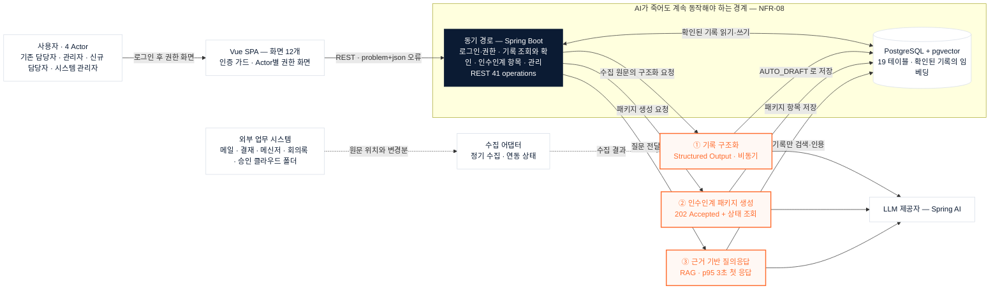

# Mermaid — 서비스 연결관계

> `아키텍처-AI접점.png`와 같은 내용을 Mermaid로 옮긴 것.
> 원본 정의는 `service-graph.mmd`이며 아래 코드와 같다.
> mermaid.live 또는 Mermaid 11 환경에서 파싱·렌더를 확인했다.

## 1. 바로 붙여넣는 코드



가로가 너무 길면 첫 줄만 `flowchart TD`로, `subgraph` 안의 `direction LR`은 그대로 두면
층이 위에서 아래로 쌓인다.

## 2. 연결관계 표

코드를 손으로 고칠 때는 이 표를 먼저 고치고 코드에 옮기면 어긋나지 않는다.

| 출발 | 도착 | 선 | 라벨 | 뜻 |
|---|---|---|---|---|
| `ACTOR` | `SPA` | 실선 | 로그인 후 권한 화면 | 인증을 통과해야 화면이 열린다 (FR-01) |
| `SPA` | `API` | 실선 | REST · problem+json 오류 | 41개 오퍼레이션. 오류 형태를 하나로 고정 |
| `API` | `DB` | 실선 양방향 | 확인된 기록 읽기·쓰기 | AI를 거치지 않는 경로 |
| `API` | `AI1` | 실선 | 수집 원문의 구조화 요청 | 비동기 (FR-05) |
| `API` | `AI2` | 실선 | 패키지 생성 요청 | `202 Accepted` 후 상태 조회 (NFR-07) |
| `API` | `AI3` | 실선 | 질문 전달 | 첫 응답 p95 3초 (NFR-06) |
| `AI1` | `DB` | 실선 | `AUTO_DRAFT` 로 저장 | 사람이 확인하기 전까지 근거가 아니다 |
| `AI2` | `DB` | 실선 | 패키지 항목 저장 | 확인된 기록만 들어간다 |
| `AI3` | `DB` | 실선 | 확인된 기록만 검색·인용 | 미확인 초안은 색인 대상이 아니다 |
| `AI1`·`AI2`·`AI3` | `LLM` | 실선 | — | 셋이 같은 제공자를 호출한다 |
| `EXT` | `ADP` | 점선 | 원문 위치와 변경분 | 원문은 외부에 남고 위치만 넘어온다 |
| `ADP` | `AI1` | 점선 | 수집 결과 | 신규·변경 파일만 구조화 대상이 된다 |

**점선은 외부 유입이고 실선은 서비스 내부다.** 둘을 같은 선으로 그리면
「우리가 통제하는 것」과 「밖에서 들어오는 것」이 구분되지 않는다.

## 3. 다시 그리게 할 때 쓰는 프롬프트

그림을 다른 도구나 AI에 넘겨 새로 그리려면 아래를 그대로 준다.

```text
사내 프로젝트 인수인계 서비스 "Project Baton"의 서비스 연결관계를 Mermaid flowchart로 그려라.

노드 10개
- ACTOR: 사용자 4 Actor (기존 담당자, 프로젝트 관리자, 신규 담당자, 시스템 관리자)
- SPA: Vue SPA, 화면 12개, 인증 가드와 Actor별 권한 화면
- API: 동기 경로 Spring Boot. 로그인·권한, 기록 조회와 확인, 인수인계 항목, 관리. REST 41 operations
- DB: PostgreSQL + pgvector. 19 테이블과 확인된 기록의 임베딩. 원통 모양
- AI1: 기록 구조화. Structured Output, 비동기
- AI2: 인수인계 패키지 생성. 202 Accepted 후 상태 조회
- AI3: 근거 기반 질의응답. RAG, 첫 응답 p95 3초
- LLM: LLM 제공자, Spring AI
- EXT: 외부 업무 시스템 (메일, 결재, 메신저, 회의록, 승인된 클라우드 업무 폴더)
- ADP: 수집 어댑터. 정기 수집과 연동 상태

간선
- ACTOR -> SPA "로그인 후 권한 화면"
- SPA -> API "REST · problem+json 오류"
- API <-> DB "확인된 기록 읽기·쓰기"
- API -> AI1 "수집 원문의 구조화 요청"
- API -> AI2 "패키지 생성 요청"
- API -> AI3 "질문 전달"
- AI1 -> DB "AUTO_DRAFT 로 저장"
- AI2 -> DB "패키지 항목 저장"
- AI3 -> DB "확인된 기록만 검색·인용"
- AI1 -> LLM, AI2 -> LLM, AI3 -> LLM (라벨 없음)
- EXT -.-> ADP "원문 위치와 변경분" (점선)
- ADP -.-> AI1 "수집 결과" (점선)

묶음
- API와 DB를 subgraph로 묶고 제목은 "AI가 죽어도 계속 동작해야 하는 경계 — NFR-08"

색
- AI1, AI2, AI3: 테두리 #FF6B2C, 배경 #FFF8F4, 글자 #FF6B2C
- API: 배경 #0B1B33, 흰 글자
- 나머지: 흰 배경, 테두리 #D6DDE6, 글자 #0B1B33
- 선: #5B6B80

규칙
- 외부에서 들어오는 간선만 점선으로, 서비스 내부는 실선으로 그린다
- AI가 도는 자리와 그렇지 않은 자리가 색으로 구분되어야 한다
```

## 4. 데이터 모델 쪽 Mermaid

테이블 사이의 관계는 별도 파일에 이미 있다.

| 파일 | 내용 |
|---|---|
| `../erd/full.mmd` | 19개 테이블 전체 ERD. `ProjectBaton-DB.dbml`에서 자동 생성 |

`tools/erd_export.py`가 DBML을 읽어 만들므로 스키마가 바뀌면 다시 돌리면 된다.
