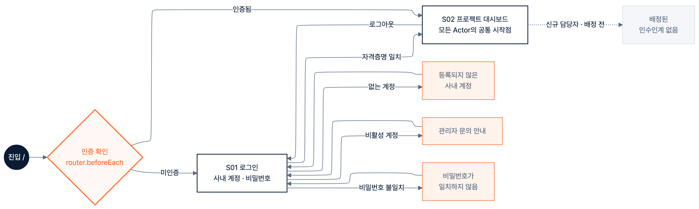
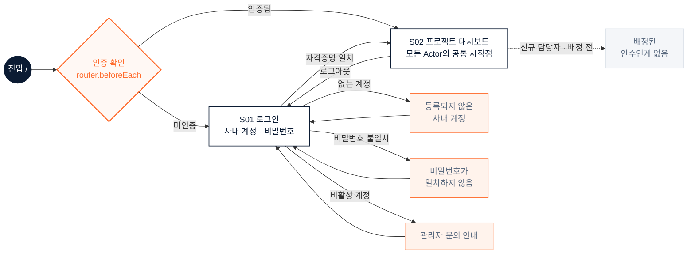
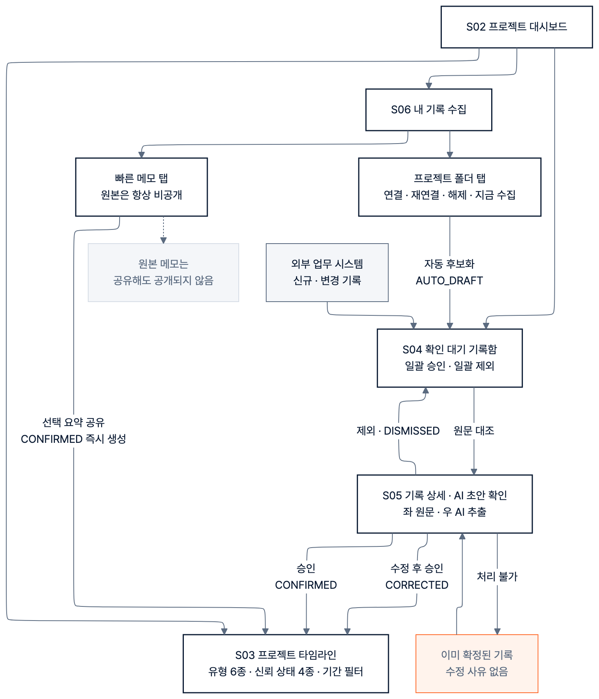
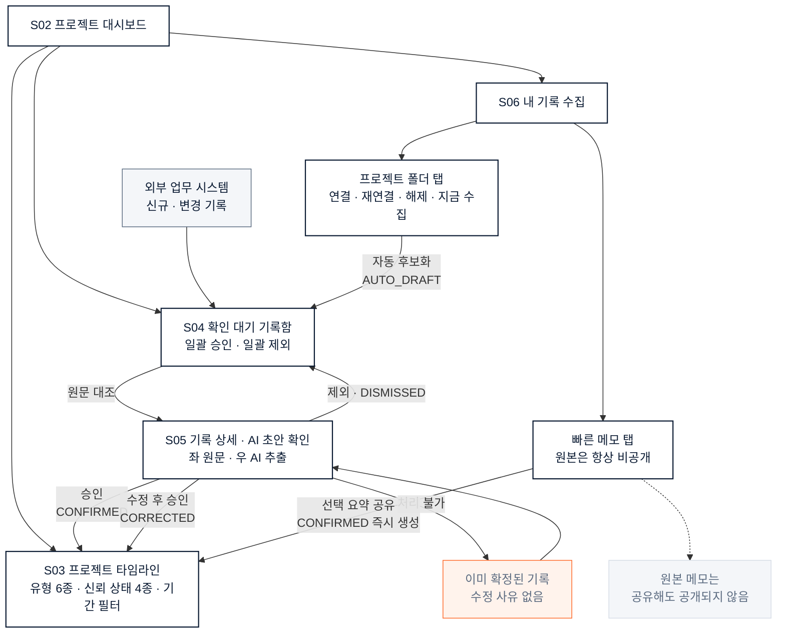
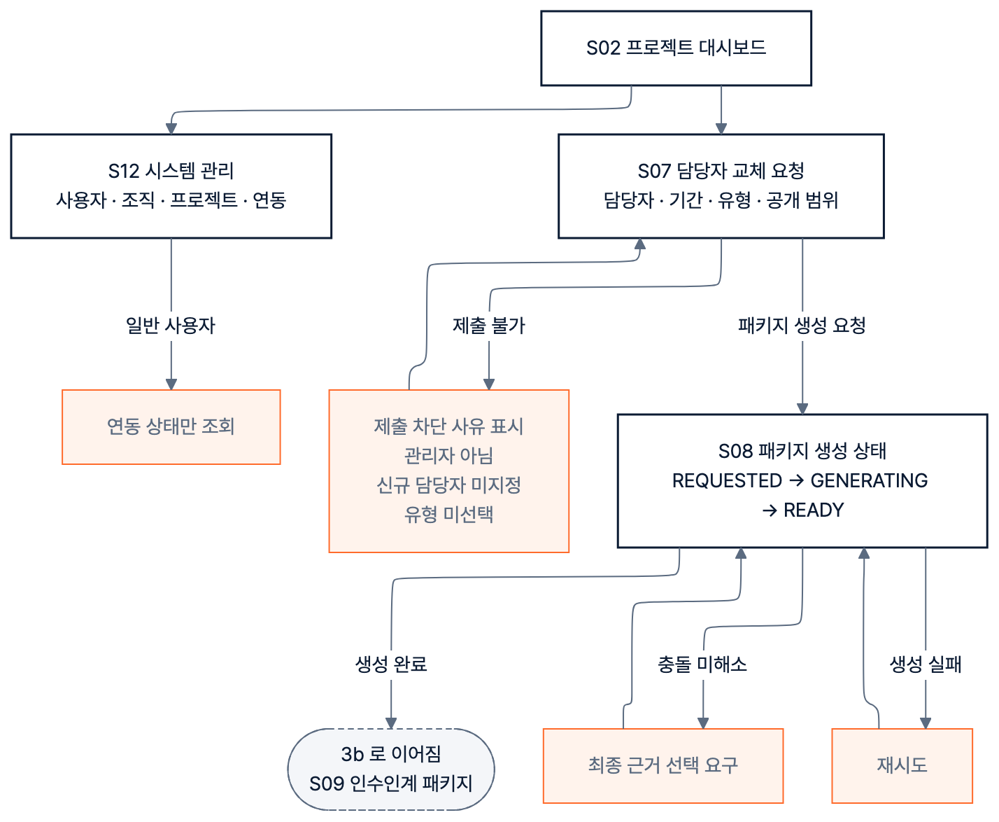
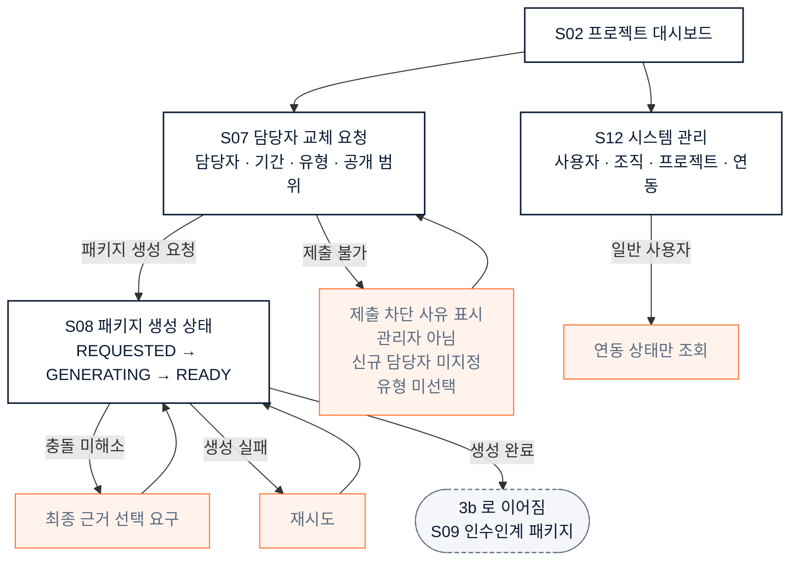
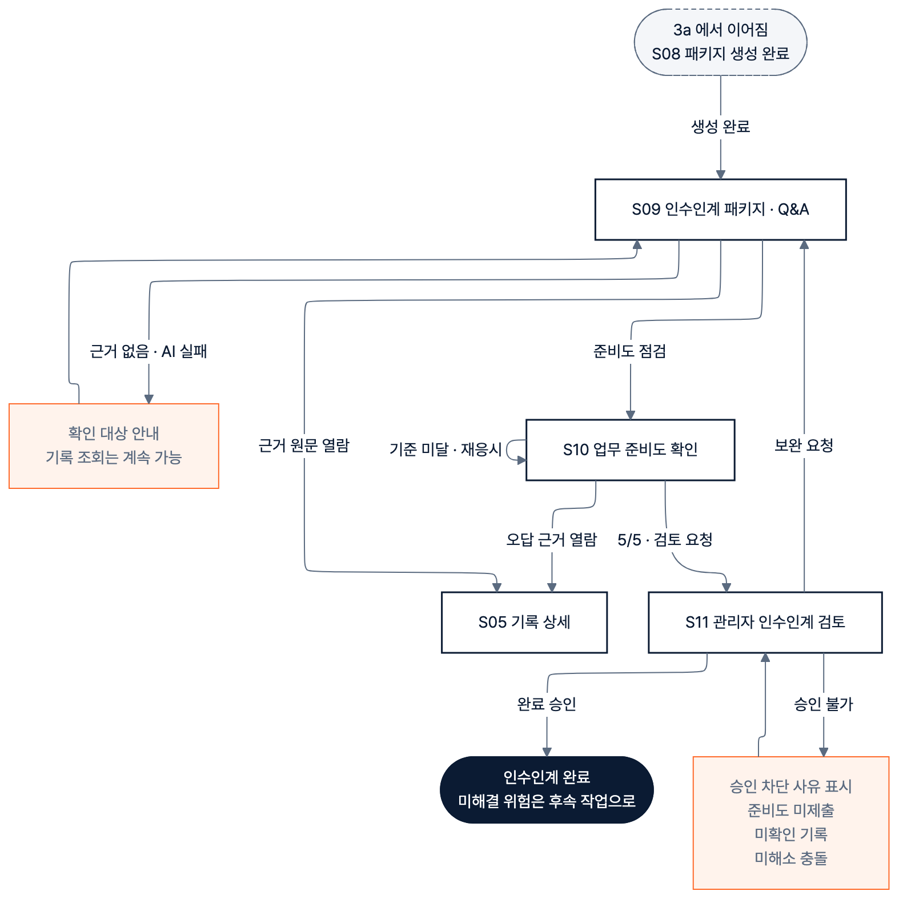
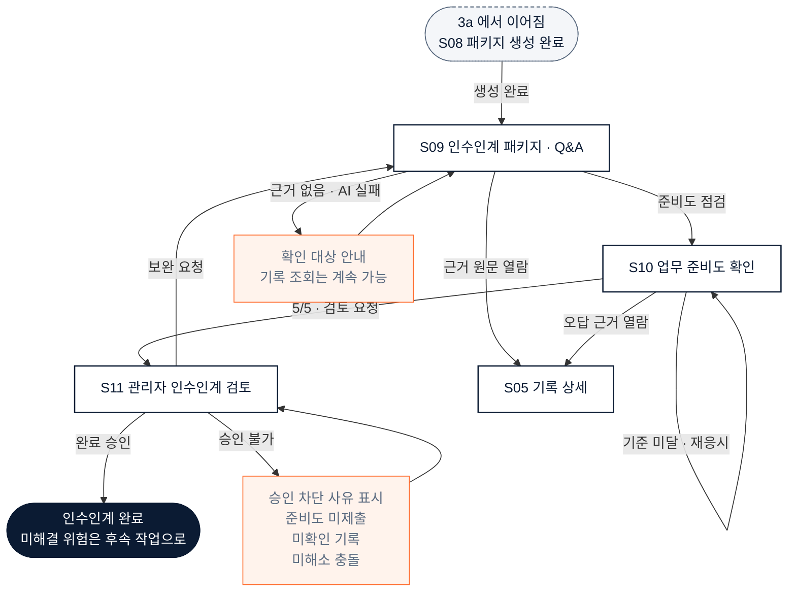

# UI 흐름도 — 화면 전이

> 작성: Claude / 2026-09-09
> 원본: `flow-1-auth.mmd` · `flow-2-record.mmd` · `flow-3-handover-request.mmd` · `flow-4-handover-learn.mmd`
> 생성: `.venv/bin/python tools/uiflow_export.py` — 손으로 고치지 말 것
> Mermaid 11에서 파싱·렌더 확인. 모든 전이를 실제 코드(`router`, 각 화면의 `router.push`)에서 뽑았다.

## UI 흐름도가 무엇인가

**화면 사이의 이동 경로를 그린 도면**이다. 세 가지를 답한다.

1. 어떤 화면이 있는가
2. 어느 화면에서 어느 화면으로 갈 수 있는가
3. 그 이동이 무슨 조건에서 일어나는가 — 성공·실패·권한 부족

**와이어프레임과 다르다.** 와이어프레임은 화면 하나의 내부 배치(버튼·입력·표)를 그리고,
흐름도는 화면들 사이의 관계를 그린다. 과제 §5 목차 3번이 둘을 함께 요구한다.

과제 세부 평가에서 이 도면이 담당하는 항목은 셋이다.

- 서비스 요구사항의 **모든** 기능이 UI 흐름에 반영되었는가
- 주요 화면 목록과 사용자 흐름이 정의되었는가
- **예외·오류 시나리오가 포함되었는가** (가점 항목)

## 1. 인증과 진입

## 2. 평상시 기록 축적

## 3. 담당자 교체와 패키지 생성

프로젝트 관리자의 구간이다.

## 4. 학습과 완료 승인

신규 담당자가 배우고, 관리자가 닫는 구간이다.

## 왜 넷으로 나눴나

12개 화면과 예외 분기를 한 장에 넣으면 선이 엉키고 라벨이 겹쳐 읽을 수 없다.
기획서 §3의 구분(축적 / 인수인계)을 따르되 두 번 더 쪼갰다.

**인증을 뺀 이유**는 로그인이 실제 인증으로 바뀌면서 분기가 넷으로 늘었기 때문이다.

**담당자 교체를 둘로 나눈 이유는 슬라이드 글자 크기다.** 이 구간은 순차 단계가
일곱이라 한 장으로 그리면 세로로 깊어진다. 16:9 슬라이드에 높이를 맞춰 넣으면
상자 글자가 5.4pt로 떨어져 이 프로젝트가 정한 최소 8pt 아래가 된다. 액터 경계에서
둘로 나누니 10.3pt와 8.1pt가 됐다.

**나누면서 잃은 관계는 없다.** 경계를 넘는 간선은 `S08 → S09` 하나뿐이고 그것은
양쪽 도면에 점선 상자로 겹쳐 그렸다. 분할 전후의 간선 22개와 노드 15개를 대조해
빠짐과 늘어남이 각각 0임을 확인했다.

## 기획서 §3과의 차이 — Codex 동기화 필요

`DAY1_서비스_기획_확정안.md` §3.2·§3.3의 흐름도는 로그인이 인증으로 바뀌기 전에
작성되어 아래 네 가지가 빠져 있다.

| # | 빠진 것 | 근거 |
|---|---|---|
| 1 | **인증 가드** — 미인증이면 12개 경로 어디도 열리지 않고 `/login`으로 돌아온다 | `src/router/index.ts`의 `beforeEach` |
| 2 | **로그인 실패 분기 3종** — 없는 계정 · 비밀번호 불일치 · 비활성 계정 | `SignInError`의 `UNKNOWN_ID` · `WRONG_CREDENTIAL` · `INACTIVE` |
| 3 | **로그아웃** — S02에서 S01로 돌아가는 경로 | `ActorSwitcher.onSignOut()` |
| 4 | **S12 진입 경로** — §3.2에도 §3.3에도 S12로 가는 화살표가 없다 | `AppShell`의 레일 `/admin` |

§3.3의 `M9 승인` 분기도 실제로는 조건 셋(준비도 미제출·미확인 기록·미해소 충돌)이
걸려 있는데 단선으로 그려져 있다.

## 이 도면이 보증하는 것과 아닌 것

모든 전이를 코드에서 뽑았다 — `router/routes.ts`의 12개 경로, 각 화면의 `router.push`
목적지, `beforeEach` 가드, 실패 분기의 오류 타입이다. **화면에 없는 이동을 그리지 않았다.**

다만 반대 방향은 보증하지 않는다. 코드에 있는 이동을 이 도면이 빠뜨렸는지는
기계로 확인하지 않았다. 필요하면 `router.push` 목적지 목록과 도면의 간선을 대조하는
검사를 붙일 수 있다.
